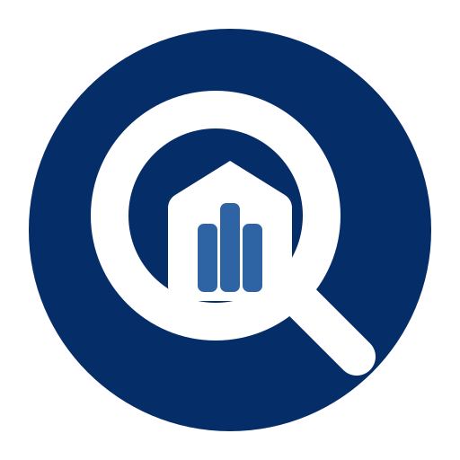

<div align="center">
  
  <h1>provjera.hr MCP server</h1>
  <p>Croatian company and association data for AI assistants: registry, financials, licences, concessions, bankruptcy notices and public funding. Look up any company by name, OIB or MBS from Claude, Codex, Cursor or VS Code.</p>
  <p>
    <a href="https://cursor.com/en/install-mcp?name=provjera-hr&config=eyJ1cmwiOiJodHRwczovL3Byb3ZqZXJhLmhyL21jcCIsImhlYWRlcnMiOnsiQXV0aG9yaXphdGlvbiI6IkJlYXJlciBZT1VSX0FQSV9LRVkifX0%3D"></a>
    <a href="https://insiders.vscode.dev/redirect/mcp/install?name=provjera-hr&config=%7B%22type%22%3A%22http%22%2C%22url%22%3A%22https%3A//provjera.hr/mcp%22%2C%22headers%22%3A%7B%22Authorization%22%3A%22Bearer%20%24%7Binput%3Aprovjera-key%7D%22%7D%7D&inputs=%5B%7B%22type%22%3A%22promptString%22%2C%22id%22%3A%22provjera-key%22%2C%22description%22%3A%22provjera.hr%20API%20key%22%2C%22password%22%3Atrue%7D%5D"></a>
    <a href="https://provjera.hr/api-i-podaci/kljuc"></a>
  </p>
  <p>
    
    
    
  </p>
  <p>
    <a href="https://provjera.hr/api-i-podaci"><b>Plans</b></a> ·
    <a href="https://provjera.hr/v1/openapi.json"><b>REST API (OpenAPI)</b></a> ·
    <a href="#hrvatski"><b>Hrvatski</b></a>
  </p>
</div>

## What you can ask

- "Find the OIB of Podravka d.d. and show its registered seat and main activity."
- "Is this company in bankruptcy or liquidation? Show the court notices."
- "Compare revenue and profit for the last five filed years."
- "Which licences does this company hold: HANFA, HNB, HAKOM, HERA, road transport, private security?"
- "Which concessions does this company hold, and from which grantor?"
- "Did this company receive APPRRR subsidies or win EU tenders?"
- "Show the registry data for this association (udruga)."

## Connect

The server is hosted at `https://provjera.hr/mcp`. There is nothing to install. Its source code is not public; this repository holds the documentation and the [MCP Registry](https://registry.modelcontextprotocol.io) entry. Every request sends your key as `Authorization: Bearer <key>`. Get a free key at [provjera.hr/api-i-podaci/kljuc](https://provjera.hr/api-i-podaci/kljuc).

**Claude Code**

```bash
claude mcp add --transport http provjera-hr https://provjera.hr/mcp --header "Authorization: Bearer YOUR_API_KEY"
```

**Codex**

```bash
export PROVJERA_API_KEY=YOUR_API_KEY
codex mcp add provjera-hr --url https://provjera.hr/mcp --bearer-token-env-var PROVJERA_API_KEY
```

**Claude (web and desktop):** Settings, Connectors, Add custom connector. URL `https://provjera.hr/mcp`, and under Request headers (beta, not yet on every account) add `Authorization` with the value `Bearer YOUR_API_KEY`.

**Cursor, Windsurf and other clients with a JSON config**

```json
{
  "mcpServers": {
    "provjera-hr": {
      "url": "https://provjera.hr/mcp",
      "headers": { "Authorization": "Bearer YOUR_API_KEY" }
    }
  }
}
```

## Tools

| Tool | Returns | Plan |
|---|---|---|
| `search` | Companies by name, OIB or MBS | Free |
| `get_company` | Registry profile, LEI, seat coordinates. Lite adds status proceedings, bankruptcy notices, filed statements, latest revenue and profit | Free |
| `get_association` | Association (udruga) by OIB. Lite adds activities and role counts | Free |
| `get_court_notices` | e-Oglasna bankruptcy notices, newest first | Lite |
| `get_financials` | FINA headline figures in EUR for every verified year | Standard |
| `get_licences` | Licences and concessions: road transport (NRCP), telecom (HAKOM), energy (HERA), financial services (HANFA), banking (HNB), media (AEM), private security (MUP), veterinary, public sector (RKPFI), customs (Carinska uprava) and concessions held (Registar koncesija) | Standard |
| `get_public_funding` | APPRRR subsidies and TED award notices | Standard |
| `get_usage` | Your plan and this month's usage | Free |

All tools are read-only. No personal data: people in a register appear only as role counts.

## Plans

| Plan | Lookups a month | Price |
|---|---|---|
| Free | 100 | 0 EUR |
| Lite | 1,000 | 29 EUR a month |
| Standard | 15,000 | 79 EUR a month |
| Pro | 100,000 | 199 EUR a month |

Search uses no lookups (up to 20 searches per monthly lookup). The same key works for the REST API at `https://provjera.hr/v1`. Details: [provjera.hr/api-i-podaci](https://provjera.hr/api-i-podaci).

## Data sources

Sudski registar RH, FINA RGFI javna objava, Registar udruga (associations), e-Oglasna ploča sudova, Registar koncesija, APPRRR Baza korisnika potpora, TED (Službeni list Europske unije), Nacionalni registar cestovnih prijevoznika, HANFA, HNB, HAKOM, HERA, AEM, MUP, Carinska uprava and Veterinarstvo registers, GLEIF LEI registar, and more.

## Licence

The files in this repository are MIT licensed ([LICENSE](LICENSE)). Data returned by the API and MCP server is governed by the [provjera.hr API and data terms](https://provjera.hr/uvjeti-za-api-i-podatke).

## Hrvatski

MCP poslužitelj provjera.hr daje AI asistentima podatke o hrvatskim tvrtkama i udrugama: Sudski registar, FINA godišnji financijski izvještaji, dozvole i licencije, koncesije, stečajni oglasi s e-Oglasne ploče, potpore i EU natječaji. Pretraga po nazivu, OIB-u ili MBS-u. Poslužitelj je na `https://provjera.hr/mcp`, ključ se šalje u zaglavlju `Authorization: Bearer <ključ>`. Besplatni ključ: [provjera.hr/api-i-podaci/kljuc](https://provjera.hr/api-i-podaci/kljuc).

---

Data by [provjera.hr](https://provjera.hr). Unofficial, not affiliated with Ministarstvo pravosuđa, FINA or any other source. Questions: info@provjera.hr.
